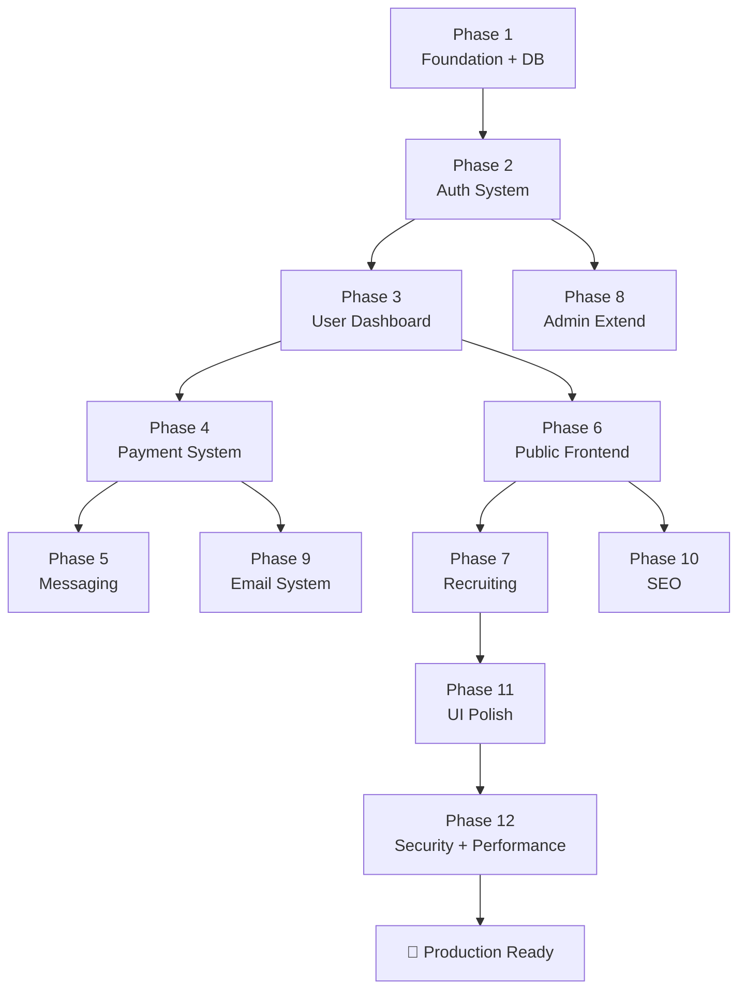

# 🏆 Sports Player Platform — Professional Build Plan

Current code status, test results, and remaining work are tracked in [Implementation Audit](IMPLEMENTATION_AUDIT.md).

> [!IMPORTANT]
> Yeh plan existing codebase ke upar build karta hai. Jo kuch already bana hua hai usse refactor kiya jayega, naya code uss pattern ko follow karega.

---

## 📊 Current State Snapshot

| Module | Status |
|--------|--------|
| Plugin Bootstrap & Autoloader | ✅ Done |
| Custom Post Types (player, team) | ✅ Done |
| Database Schema (players, teams, rankings) | ✅ Done |
| Admin Menu + Players/Teams/Rankings UI | ✅ Done |
| Shortcodes (spp_players, spp_rankings, spp_teams) | ✅ Done |
| REST API (basic) | ✅ Done |
| Auth Class (skeleton) | ⚠️ Partial |
| Membership Class (skeleton) | ⚠️ Partial |
| Messaging Class (skeleton) | ⚠️ Partial |
| Recruiting Class (skeleton) | ⚠️ Partial |
| User Dashboard | ❌ Missing |
| Payment Integration | ❌ Missing |
| Email System | ❌ Missing |
| SEO | ❌ Missing |
| Frontend Templates | ❌ Missing |

---

## 🗂️ Final Plugin File Structure

```
sports-player-platform/
├── _sports-player-platform.php          ← Main bootstrap (refactor)
├── composer.json
├── uninstall.php                        ← NEW: clean uninstall
│
├── admin/
│   ├── class-spp-admin.php              ← Refactor: dashboard widgets
│   ├── views/
│   │   ├── players.php
│   │   ├── profile-management.php
│   │   ├── teams.php
│   │   ├── rankings.php
│   │   ├── memberships.php              ← NEW
│   │   ├── messages.php                 ← NEW
│   │   ├── reports.php                  ← NEW
│   │   └── settings.php                 ← NEW
│
├── includes/
│   ├── functions.php                    ← Refactor: helpers
│   ├── auth/
│   │   └── class-spp-auth.php           ← Complete
│   ├── database/
│   │   └── class-spp-db.php             ← Extend: new tables
│   ├── email/
│   │   ├── class-spp-email.php          ← NEW
│   │   └── templates/
│   │       ├── welcome.php
│   │       ├── verify-email.php
│   │       ├── password-reset.php
│   │       ├── membership-confirm.php
│   │       └── payment-receipt.php
│   ├── frontend/
│   │   └── class-spp-frontend.php       ← Extend: SEO meta
│   ├── membership/
│   │   └── class-spp-membership.php     ← Complete
│   ├── messaging/
│   │   └── class-spp-messaging.php      ← Complete
│   ├── payment/
│   │   ├── class-spp-payment.php        ← NEW: gateway abstraction
│   │   ├── class-spp-stripe.php         ← NEW
│   │   └── class-spp-paypal.php         ← NEW
│   ├── recruiting/
│   │   └── class-spp-recruiting.php     ← Complete
│   ├── seo/
│   │   └── class-spp-seo.php            ← NEW
│   └── settings/
│       └── class-spp-settings.php       ← Complete
│
├── public/
│   └── class-spp-public.php             ← Refactor
│
├── templates/
│   ├── dashboard/
│   │   ├── dashboard.php                ← NEW: user dashboard
│   │   ├── edit-profile.php             ← NEW
│   │   ├── membership.php               ← NEW
│   │   ├── messages.php                 ← NEW
│   │   └── shortlist.php                ← NEW
│   ├── player/
│   │   ├── single-player.php            ← NEW: single player page
│   │   ├── archive-player.php           ← NEW: player listing
│   │   └── player-card.php              ← NEW: reusable card
│   ├── team/
│   │   ├── single-team.php              ← NEW
│   │   └── archive-team.php             ← NEW
│   ├── auth/
│   │   ├── login.php                    ← NEW
│   │   ├── register.php                 ← NEW
│   │   └── reset-password.php           ← NEW
│   └── rankings/
│       └── rankings-table.php           ← NEW
│
├── assets/
│   ├── css/
│   │   ├── admin.css                    ← Extend
│   │   ├── public.css                   ← Extend
│   │   └── dashboard.css                ← NEW
│   └── js/
│       ├── admin.js                     ← Extend
│       ├── public.js                    ← Extend
│       └── dashboard.js                 ← NEW
│
└── modules/
    └── core/
        └── bootstrap.php
```

---

## 🔢 Build Phases — Step by Step

---

### PHASE 1 — Foundation Cleanup & Database
**Goal:** Existing code ko stable karo, database schema complete karo

#### 1.1 — Database Schema Complete Karo
Existing tables:
- `spp_players` ✅
- `spp_teams` ✅
- `spp_rankings` ✅
- `spp_rankings_history` ✅
- `spp_ranking_categories` ✅
- `spp_memberships` ✅ (skeleton)

**Naye tables banana hai:**

| Table | Purpose |
|-------|---------|
| `spp_messages` | Conversations between users |
| `spp_message_threads` | Thread/conversation grouping |
| `spp_recruiting_lists` | Coach ke recruiting lists |
| `spp_recruiting_players` | List ke andar players |
| `spp_notifications` | In-app notifications |
| `spp_player_views` | Profile view tracking |
| `spp_payment_logs` | Payment history |
| `spp_email_logs` | Email audit log |

**`spp_messages` schema:**
```sql
id, thread_id, sender_id, receiver_id, 
message TEXT, is_read TINYINT, 
created_at, deleted_by_sender, deleted_by_receiver
```

**`spp_recruiting_lists` schema:**
```sql
id, coach_user_id, list_name, description, 
sport VARCHAR(100), is_private, created_at, updated_at
```

#### 1.2 — Plugin Bootstrap Refactor
- `uninstall.php` alag file mein nikalo (WordPress best practice)
- Constants ko ek jagah centralize karo
- Error handling aur logging add karo (`WP_DEBUG` ke through)
- Version migration system: DB version change pe auto `dbDelta` run

#### 1.3 — Helper Functions (`includes/functions.php`)
- `spp_get_player_meta($post_id, $key)` — sanitized meta getter
- `spp_get_current_user_role()` — role check helper
- `spp_user_has_membership($user_id, $type)` — membership check
- `spp_get_avatar_url($user_id)` — Gravatar + custom fallback
- `spp_format_date($date)` — localized date format
- `spp_log($message, $level)` — debug logger

---

### PHASE 2 — Authentication System (Complete)
**Goal:** Registration, Login, Email Verify, Password Reset — fully working

#### 2.1 — User Roles (Already Partial — Complete Karo)
```
spp_player    → Apna profile manage kare, messages receive kare
spp_parent    → Players browse kare, shortlist banaye
spp_coach     → Recruiting lists banaye, players contact kare
```
Capabilities matrix:
| Capability | Player | Parent | Coach |
|------------|--------|--------|-------|
| edit_own_profile | ✅ | ❌ | ❌ |
| browse_players | ✅ | ✅ | ✅ |
| send_messages | ✅ (coach se) | ❌ | ✅ |
| create_recruiting_list | ❌ | ❌ | ✅ |
| view_contact_info | ❌ | 💳 Paid | 💳 Paid |

#### 2.2 — Registration Flow
1. User `/register` page pe jaata hai
2. `[spp_register_form]` shortcode form dikhata hai
3. Fields: Name, Email, Password, Role (Player/Parent/Coach), Sport
4. Submit pe:
   - `wp_create_user()` se user banta hai
   - Verification email bheja jaata hai (token ke saath)
   - User ko "unverified" status milta hai
   - Redirect to "Check your email" page

#### 2.3 — Email Verification
- Token `wp_generate_password(32, false)` se generate hoga
- User meta `spp_email_verify_token` mein store hoga
- Verify URL: `/verify-email/?token=xxxx`
- Verify hone pe `spp_email_verified = 1` set hoga
- Login tabhi allow hoga jab verified ho

#### 2.4 — Login Flow
- `[spp_login_form]` shortcode
- WordPress `wp_signon()` use karo
- Unverified user ko error dikhao with resend link
- Remember me support
- Login ke baad role-wise redirect:
  - Player → `/dashboard/`
  - Coach → `/dashboard/recruiting/`
  - Admin → `/wp-admin/`

#### 2.5 — Password Reset
- `[spp_password_reset_form]` shortcode — already skeleton hai
- Step 1: Email enter karo → `get_password_reset_key()` → email bhejo
- Step 2: Link pe click → new password form dikhao
- Step 3: `reset_password()` call karo

#### 2.6 — Auth Guards (Template Redirect)
```php
// Dashboard pages pe login check
if (!is_user_logged_in()) → /login/ pe redirect
// Membership-gated pages pe membership check
if (!spp_user_has_membership($user_id, 'paid')) → /pricing/ pe redirect
```

---

### PHASE 3 — User Dashboard
**Goal:** Logged-in user ka personal control panel

#### 3.1 — Dashboard Pages (WordPress Pages + Shortcodes)

| Page Slug | Shortcode | Access |
|-----------|-----------|--------|
| `/dashboard/` | `[spp_dashboard]` | All logged-in |
| `/dashboard/edit-profile/` | `[spp_edit_profile]` | Player only |
| `/dashboard/membership/` | `[spp_my_membership]` | All logged-in |
| `/dashboard/messages/` | `[spp_messages]` | Paid members |
| `/dashboard/shortlist/` | `[spp_shortlist]` | Coach/Parent |
| `/dashboard/recruiting/` | `[spp_recruiting_lists]` | Coach recruiting lists |

#### 3.2 — Dashboard Home Widget
- Welcome message + user avatar
- Membership status badge (Free / Monthly / Annual)
- Quick stats:
  - Player: "Profile views this month", "Messages received"
  - Coach: "Players shortlisted", "Messages sent", "Recruiting lists"
- Quick links to sub-pages

#### 3.3 — Edit Profile (Player)
- Tabbed form:
  - **Tab 1 — Personal:** Name, DOB, Location, Photo upload
  - **Tab 2 — Athletic:** Sport, Position, Height, Weight, Graduation Year, School
  - **Tab 3 — Media:** Photo gallery (upload multiple), Highlight video URL (YouTube/Vimeo embed)
  - **Tab 4 — Academic:** GPA, SAT/ACT scores, Awards
- AJAX save (no page reload)
- Profile completion percentage indicator
- Admin approval required for public visibility → `spp_pending` status set hoga

#### 3.4 — Membership Tab
- Current plan display
- Upgrade/downgrade buttons
- Payment history table (from `spp_payment_logs`)
- Cancel subscription button

---

### PHASE 4 — Membership & Payment System
**Goal:** Stripe/PayPal ke through paid plans

#### 4.1 — Membership Plans

| Plan | Price | Features |
|------|-------|---------|
| **Free** | \$0 | Browse players (no contact info), No messaging |
| **Monthly** | \$29/mo | Full contact info, 50 messages/month, 5 recruiting lists |
| **Annual** | \$249/yr | Everything + unlimited messages + priority support |

#### 4.2 — Payment Gateway Abstraction (`class-spp-payment.php`)
```php
interface SPP_Payment_Gateway {
    public function create_session(array $plan): string; // returns checkout URL
    public function handle_webhook(): void;
    public function cancel_subscription(string $sub_id): bool;
}
```
- `SPP_Stripe` implements this interface
- `SPP_PayPal` implements this interface
- Settings mein admin choose kare konsa gateway active hai

#### 4.3 — Stripe Integration
- WordPress HTTP API se hosted Stripe Checkout create karo.
- Checkout flow:
  1. User "Upgrade" button click kare
  2. Stripe Checkout Sessions API se session bane
  3. User Stripe hosted page pe jaaye
  4. Payment complete pe webhook fire ho → `spp/v1/stripe-webhook`
  5. Webhook handler:
     - `invoice.paid` → membership activate ya renew karo
     - `invoice.payment_failed` → membership pause karo
     - `customer.subscription.deleted` → membership cancel karo
- Webhook ka timestamp aur signature verify karo.

#### 4.4 — PayPal Integration
- PayPal Subscriptions API par monthly aur annual recurring plans configure karo.
- Provider se webhook verify karo. `PAYMENT.SALE.COMPLETED` se membership activate ya renew karo.

#### 4.5 — Pricing Page
- `[spp_pricing_table]` shortcode
- 3-column plan cards (Free / Monthly / Annual)
- Highlighted "Most Popular" badge Annual pe
- Plan comparison table
- Current plan highlight for logged-in users

---

### PHASE 5 — Messaging System
**Goal:** Coach ↔ Player direct messaging

#### 5.1 — Thread-based Conversations
- Thread = ek conversation between 2 users
- `spp_message_threads`: thread_id, user1_id, user2_id, last_message_at
- `spp_messages`: message records with thread_id

#### 5.2 — Messaging UI (`[spp_messages]` shortcode)
- Left panel: Conversation list (sorted by last message)
- Right panel: Message thread view
- Send message form at bottom
- Unread count badge in dashboard nav
- Real-time feel: AJAX polling every 5 seconds (ya WP REST API long poll)

#### 5.3 — Messaging Rules
- Sirf paid members message kar sakte hain
- Coach → Player message bhej sakta hai
- Player → Coach reply kar sakta hai
- Parent messaging disabled (upsell dikhao)
- Monthly plan: 50 messages/month limit (counter in `spp_memberships`)
- Annual plan: Unlimited

#### 5.4 — Message Notifications
- Email notification jab naya message aaye (opt-in)
- In-app notification bell icon dashboard mein
- Notifications table: `spp_notifications`

---

### PHASE 6 — Player Directory & Profiles (Public Frontend)
**Goal:** Public-facing pages professional dikhein

#### 6.1 — Player Archive Page (`/players/`)
- Filter sidebar:
  - Sport (dropdown)
  - Position (dropdown)
  - Graduation Year (range slider)
  - Location (text input)
  - Height range
- Results grid: Player cards (photo, name, sport, position, school)
- Pagination
- Sort by: Name, Graduation Year, Recently Added
- AJAX filtering (no page reload)
- SEO: Proper H1, meta description, pagination canonical

#### 6.2 — Single Player Profile (`/players/{slug}/`)
Layout:
```
┌─────────────────────────────────────────┐
│ [Hero: Player Photo + Name + Sport]     │
├──────────────┬──────────────────────────┤
│ Stats Sidebar│ Main Content             │
│ • Height     │ • About / Bio            │
│ • Weight     │ • Athletic Stats         │
│ • Position   │ • Photo Gallery          │
│ • School     │ • Highlight Video        │
│ • Grad Year  │ • Academic Info          │
│              │ • Awards & Achievements  │
│ [Contact]    │                          │
│ (Paid only)  │                          │
│ [Add to List]│                          │
│ (Coach only) │                          │
└──────────────┴──────────────────────────┘
```
- Contact info blur/locked for free users → "Upgrade to view"
- Profile view tracked in `spp_player_views`
- Schema.org structured data: `Person` type

#### 6.3 — Team Archive & Single Pages
- `/teams/` — Team listing with sport filter
- `/teams/{slug}/` — Team detail with roster list

#### 6.4 — Rankings Page (`/rankings/`)
- `[spp_rankings]` shortcode
- Category tabs (National, Regional, State, etc.)
- Table: Rank, Player Name (linked), Sport, Position, School, Location
- Previous rank vs current rank indicator (↑↓)

---

### PHASE 7 — Recruiting Module
**Goal:** Coach ke liye structured recruiting tools

#### 7.1 — Recruiting Lists
- Coach unlimited lists bana sakta hai (paid plan)
- List fields: Name, Sport, Description, Private/Public toggle
- Players add karo list mein (player profile se "Add to List" button)
- List export: PDF ya CSV

#### 7.2 — Shortlist Dashboard
- `[spp_recruiting]` shortcode
- Lists overview cards
- Click karo → List ke players dikhen (player cards)
- Remove player from list
- Notes field per player in list (`spp_recruiting_players.notes`)

#### 7.3 — Player Interest Tracking
- Jab coach player ka profile dekhe → `spp_player_views` mein log ho
- Player dashboard mein dikhe: "Your profile was viewed by X coaches this month"
- Coach ki identity hidden (privacy)

---

### PHASE 8 — Admin Panel (Extend Existing)
**Goal:** Admin ko puri control den

#### 8.1 — Existing Pages (Already Done)
- Players listing ✅
- Profile approval/rejection ✅
- Teams management ✅
- Rankings management ✅

#### 8.2 — New Admin Pages

**Memberships Page** (`/wp-admin/admin.php?page=spp-memberships`)
- Table: User, Plan, Status, Started, Expires, Payment Method
- Manual override: change plan, extend expiry
- Cancel/refund action

**Messages Page** (`/wp-admin/admin.php?page=spp-messages`)
- All conversations list
- Flag/unflag messages
- Delete conversation (abuse moderation)

**Reports Page** (`/wp-admin/admin.php?page=spp-reports`)
- Revenue chart (monthly/annual)
- New signups per day
- Active memberships count
- Most viewed players
- Messages sent per day

**Settings Page** (`/wp-admin/admin.php?page=spp-settings`)
- General: Site name, default sport
- Pages: Set which WP page = dashboard, login, register, etc.
- Payment: Stripe publishable/secret key, PayPal client/secret
- Email: From name, from email, SMTP settings
- Membership: Prices for monthly/annual plans

#### 8.3 — Dashboard Widgets
- 2 widgets on WP admin home:
  - "Pending Profile Approvals" count with link
  - "New Members This Week" chart

---

### PHASE 9 — Email System
**Goal:** Transactional emails professionally bhejo

#### 9.1 — Email Class (`class-spp-email.php`)
```php
class SPP_Email {
    public function send(string $to, string $template, array $data): bool
    private function get_template(string $name, array $data): string
    private function get_header(): string
    private function get_footer(): string
}
```

#### 9.2 — Email Templates (HTML)
Branded email templates with plugin logo:

| Template | Trigger |
|----------|---------|
| `welcome.php` | Registration complete |
| `verify-email.php` | After registration |
| `password-reset.php` | Password reset request |
| `membership-confirm.php` | Upgrade successful |
| `payment-receipt.php` | Payment charged |
| `payment-failed.php` | Payment declined |
| `new-message.php` | New message received |
| `profile-approved.php` | Admin ne profile approve ki |
| `profile-rejected.php` | Admin ne profile reject ki |

#### 9.3 — Email Log
- Har email `spp_email_logs` table mein log ho
- Admin panel mein email log dekhne ki ability
- Resend button for failed emails

---

### PHASE 10 — SEO System
**Goal:** Search engine friendly pages

#### 10.1 — `class-spp-seo.php`
- `wp_head` mein custom meta tags inject karo
- Player profile:
  ```html
  <title>{Player Name} — {Sport} Player | {Site Name}</title>
  <meta name="description" content="{Player Name}, {position} from {school}...">
  <meta property="og:image" content="{player_photo}">
  ```
- Rankings page, Team page ke liye bhi similar

#### 10.2 — Structured Data (JSON-LD)
Player profile pe:
```json
{
  "@type": "Person",
  "name": "Player Name",
  "description": "...",
  "sport": "Soccer",
  "memberOf": { "@type": "SportsTeam", "name": "Team Name" }
}
```

#### 10.3 — XML Sitemap
- `spp_sitemap.xml` generate karo
- Player profiles, Team pages, Rankings pages include karo
- WordPress Sitemap API ke saath integrate karo

#### 10.4 — Canonical URLs & Pagination
- Archive pages pe `rel="canonical"` aur `rel="next/prev"`
- Paginated archives ka proper handling

---

### PHASE 11 — Assets & Frontend Polish
**Goal:** Professional UI/UX

#### 11.1 — CSS Architecture
- CSS custom properties (variables) for theming:
  ```css
  :root {
    --spp-primary: #1a56db;
    --spp-secondary: #111928;
    --spp-accent: #f59e0b;
    --spp-text: #374151;
  }
  ```
- Mobile-first responsive design
- Admin override: Admin settings mein primary color change karo

#### 11.2 — JavaScript
- Vanilla JS (no jQuery dependency — WordPress already loads it but avoid overuse)
- AJAX requests via `fetch()` with WP nonce
- Form validation client-side + server-side
- Dashboard messaging: polling for new messages
- Player filter: debounced AJAX on filter change

#### 11.3 — Media Handling
- Player photo upload: WordPress Media Library use karo
- Photo gallery: Multiple attachments linked to player post
- Highlight video: YouTube/Vimeo URL se oEmbed auto-generate
- Image resize: `add_image_size()` for player cards (300x300 crop)

---

### PHASE 12 — Security & Performance
**Goal:** Production-ready security

#### 12.1 — Security Checklist
- [ ] Har form mein nonce verify karo
- [ ] Sab input `sanitize_*()` se sanitize karo
- [ ] Sab output `esc_*()` se escape karo
- [ ] `$wpdb->prepare()` har SQL query mein
- [ ] Capability checks har admin action pe
- [ ] Rate limiting: login attempts (5 per 15 min)
- [ ] Stripe webhook signature verification
- [ ] File upload validation (type + size)
- [ ] SQL injection prevention
- [ ] XSS prevention

#### 12.2 — Performance
- [ ] Transients cache: Rankings data 1 hour cache
- [ ] Object cache: User membership status cache
- [ ] Lazy load player images
- [ ] Minified CSS/JS in production
- [ ] Database indexes on frequently queried columns
- [ ] `WP_Query` optimize karo (`no_found_rows`, `update_post_meta_cache`)

---

## 🗓️ Build Order (Priority Sequence)



---

## 📋 Shortcodes — Complete Reference

| Shortcode | File | Purpose |
|-----------|------|---------|
| `[spp_login_form]` | auth/class-spp-auth.php | Login form |
| `[spp_register_form]` | auth/class-spp-auth.php | Registration form |
| `[spp_password_reset_form]` | auth/class-spp-auth.php | Reset password |
| `[spp_dashboard]` | templates/dashboard/dashboard.php | User dashboard home |
| `[spp_edit_profile]` | templates/dashboard/edit-profile.php | Edit player profile |
| `[spp_my_membership]` | templates/dashboard/membership.php | Membership status |
| `[spp_messages]` | templates/dashboard/messages.php | Messaging UI |
| `[spp_shortlist]` | templates/dashboard/shortlist.php | Saved players |
| `[spp_recruiting]` | templates/dashboard/recruiting.php | Coach recruiting lists |
| `[spp_players]` | public/class-spp-public.php | Player directory |
| `[spp_rankings]` | public/class-spp-public.php | Rankings table |
| `[spp_teams]` | public/class-spp-public.php | Teams listing |
| `[spp_pricing_table]` | includes/membership/ | Pricing plans |
| `[spp_membership_status]` | includes/membership/ | Current plan widget |

---

## 🔌 REST API Endpoints — Complete Reference

| Method | Endpoint | Auth | Purpose |
|--------|----------|------|---------|
| GET | `/spp/v1/players` | Public | Player listing |
| GET | `/spp/v1/players/{id}` | Public | Single player |
| PUT | `/spp/v1/players/{id}` | Player | Update own profile |
| GET | `/spp/v1/teams` | Public | Teams listing |
| GET | `/spp/v1/rankings` | Public | Rankings |
| GET | `/spp/v1/messages` | Paid | Conversation list |
| POST | `/spp/v1/messages` | Paid | Send message |
| GET | `/spp/v1/messages/{thread_id}` | Paid | Thread messages |
| GET | `/spp/v1/recruiting-lists` | Coach | Lists |
| POST | `/spp/v1/recruiting-lists` | Coach | Create list |
| POST | `/spp/v1/recruiting-lists/{id}/players` | Coach | Add player to list |
| POST | `/spp/v1/stripe-webhook` | Stripe | Payment webhook |
| POST | `/spp/v1/paypal-webhook` | PayPal | Payment webhook |
| GET | `/spp/v1/notifications` | Logged-in | User notifications |

---

## ✅ WordPress Pages to Create (Post Activation)

Plugin activate hone pe automatically yeh pages banen (activation hook mein):

| Page Title | Slug | Shortcode |
|-----------|------|-----------|
| Login | `/login/` | `[spp_login_form]` |
| Register | `/register/` | `[spp_register_form]` |
| Reset Password | `/reset-password/` | `[spp_password_reset_form]` |
| Dashboard | `/dashboard/` | `[spp_dashboard]` |
| Edit Profile | `/dashboard/edit-profile/` | `[spp_edit_profile]` |
| Membership | `/dashboard/membership/` | `[spp_my_membership]` |
| Messages | `/dashboard/messages/` | `[spp_messages]` |
| Shortlist | `/dashboard/shortlist/` | `[spp_shortlist]` |
| Recruiting | `/dashboard/recruiting/` | `[spp_recruiting_lists]` |
| Pricing | `/pricing/` | `[spp_pricing_table]` |
| Email Verify | `/verify-email/` | (handled by template_redirect) |

---

> [!TIP]
> Har phase complete karne ke baad plugin activate/deactivate karke test karo. Ek phase ek time pe implement karo sequence mein.

> [!NOTE]
> Payment integration ke liye Stripe Test Mode pehle use karo. Live keys sirf production pe lagao.
